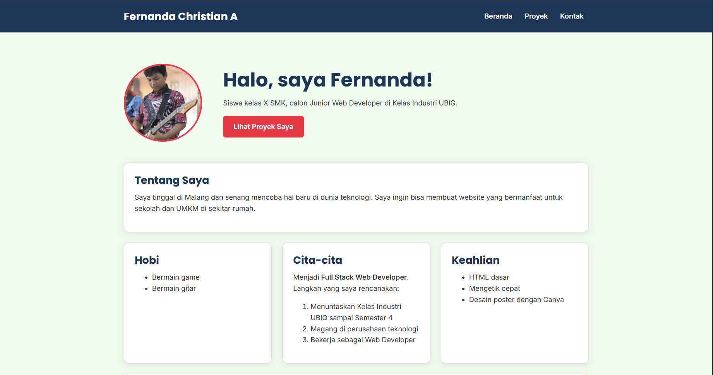
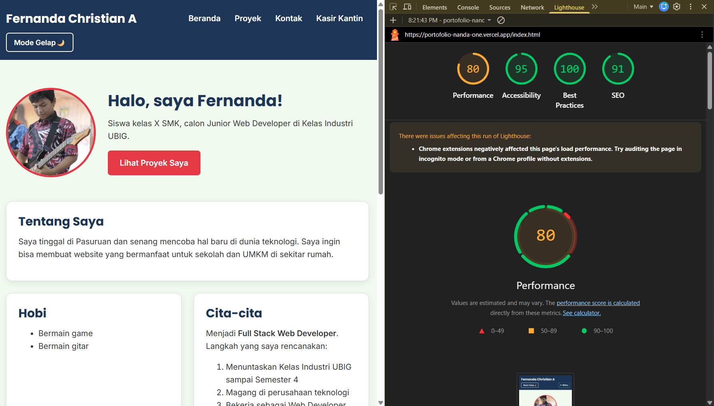

# Portofolio Fernanda Christian A
Website portofolio pribadi yang saya buat di Kelas Industri UBIG
(Paket 1, Minggu 01 sampai 09).
Website ini tampil rapi di ponsel, tablet, dan laptop.

Website ini menampilkan profil, keahlian, proyek, dan informasi kontak saya. Website dirancang responsif agar nyaman digunakan melalui ponsel, tablet, maupun laptop.

---

## Tampilan

---

## Fitur
- Halaman **Beranda** berisi profil, hobi, cita-cita, keahlian, dan jadwal belajar
- Halaman **Proyek** berisi daftar proyek dalam bentuk kartu
- Filter proyek berdasarkan kategori bahasa
- Halaman **Kontak** berisi form untuk menghubungi saya
- Penghitung karakter pada formulir kontak
- Mode terang dan gelap
- Tampilan responsif dengan Flexbox dan *media query*
- Integrasi GitHub API untuk menampilkan daftar repositori

---

## Teknologi
- HTML5
- CSS3 (Flexbox dan media query)
- Git dan GitHub
- JavaScript
- JSON
- GitHub API

---

## Pengujian Lighthouse (Mobile)

---

## Hasil Pengujian Lighthouse
Pengujian dilakukan menggunakan Lighthouse pada tiga halaman website.

| Halaman | Performance | Accessibility | Best Practices | SEO |
|---|---:|---:|---:|---:|
| Beranda | 80 | 95 | 100 | 91 |
| Proyek | 89 | 94 | 100 | 91 |
| Kontak | 99 | 94 | 100 | 90 |

---

## Tautan
- Website: [Portofolio](https://portofolio-nanda-one.vercel.app/)
- Dibuat oleh: Fernanda Chritstian A, SMKN 1 Pasuruan

---